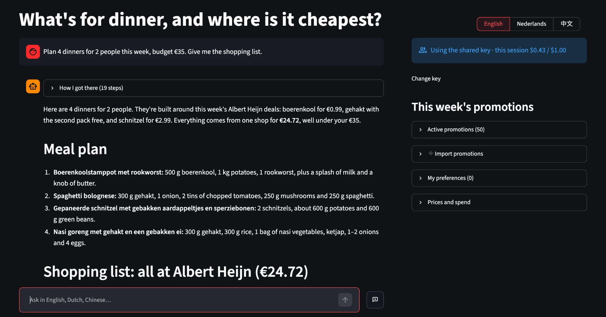

# 荷兰超市比价 + 菜谱 Agent

[English](README.md) · **在线体验：[boodschappen-agent-ming.streamlit.app](https://boodschappen-agent-ming.streamlit.app/?lang=中文)**



用自然语言规划一周饭菜，agent 会去 10 家荷兰超市查价，告诉你在哪里买最便宜。

```
you › 两个人，这周做 4 顿晚饭，预算 €35，不吃香菜，想吃点亚洲菜
  · search_products({"query": "kipfilet", ...})
  · search_products({"query": "basmati rijst", ...})
  · price_shopping_list({"items": [...]})
agent › 菜单 + 按超市分好的购物清单 + 总价（单店 vs 两店对比）
```

## 使用

```bash
python3 -m venv .venv && .venv/bin/pip install -r requirements.txt -r requirements-dev.txt
export ANTHROPIC_API_KEY=...                # 你的 Anthropic API key（建议写进 ~/.zshrc）
.venv/bin/streamlit run app.py              # 网页界面：http://localhost:8501（首次启动自动下载价格，之后每天自动更新）
.venv/bin/python -m grocery_agent update    # 也可以手动更新价格
.venv/bin/python -m grocery_agent           # 或者在终端里对话
```

### 导入每周折扣（bonus）

在网页右侧「导入折扣」里选择超市（有效期会按这家超市的折扣周自动填好），然后上传传单截图、照片或 PDF，
或者粘贴 ah.nl/bonus 等页面复制下来的文字，再点「识别并导入」。Claude 会读出每条折扣，
匹配到商品库里的具体商品；之后比价时会自动按折扣计算。导入一页传单大约花费 $0.02–0.05。

支持的折扣类型：1+1 / 2+1 gratis、“2 voor €5”、25% korting、2e halve prijs、直接降价。
其他复杂规则会显示出来，但不参与计算。

## 架构

```
Checkjebon 开源价格数据（每日更新，10 家超市，约 10 万商品）
        │  db.py：下载 → 解析包装规格 → SQLite + trigram 全文索引
        ▼
工具层 tools.py
  search_products       按荷兰语名称搜商品（子串匹配，"filet" 能搜到 "kipfilet"）
  price_shopping_list   精确计算购物篮：最便宜包装组合、单店 vs 两店对比
  list_promotions       本周已导入的折扣及其覆盖的商品
  list_stores           数据日期与超市列表
  remember/forget_preference   长期偏好记忆（家庭人数、忌口、常去的店）
        ▼
agent.py：Claude（claude-opus-5-5）+ tool runner 多轮对话
        ▲
app.py：Streamlit 界面（对话、查询过程、折扣导入、偏好管理、花费统计）

折扣：传单图片 / PDF / 文字 → promos.extract（结构化输出）→ 在商品库中搜候选
      → promos.match（让 Claude 选择适用商品，过滤掉不存在的 ID）→ promotions.db
```

**分工原则**：LLM 负责理解需求、设计菜单、判断"哪些商品算同一种东西"（实体匹配）；
所有算术（包装数量、总价、比价）都由代码完成，LLM 不自己算钱。

## 关键实现

| 模块 | 难点 | 做法 |
|---|---|---|
| `units.py` | 规格格式五花八门："ca. 400 g"、"6 x 330 ml"、"per stuk"、"1,5 L"、规格写在名字里 | 正则 + 单位表，统一成 g / ml / 个，计算 €/kg、€/L |
| `db.py` | 荷兰语复合词（kipfilet、halfvolle melk） | SQLite FTS5 trigram 子串索引；完整词匹配优先、名字短的优先 |
| `db.py` | 每日数据刷新后，对话里的商品 ID 不能失效 | 由 店+链接+名称+规格 哈希生成稳定 ID |
| `basket.py` | 需要 900 g，店里有 800 g 和 175 g 两种包装 | 无界覆盖背包 DP，求凑够数量的最便宜组合 |
| `basket.py` | 一家店买齐 vs 跑两家店 | 枚举所有单店与两店组合，报告省多少钱 |
| `basket.py` | 1+1、“2 voor €5” 让价格不再和数量成正比 | 把折扣变成额外的“捆绑包”选项放进同一个 DP；同价时优先多拿 |
| `promos.py` | 每天刷新价格不能把折扣冲掉 | 折扣单独存 `promotions.db`，靠稳定商品 ID 关联 |

界面默认是英文，右上角可以切换成荷兰语或中文；也可以直接用带 `?lang=Nederlands` 或 `?lang=中文` 的链接打开对应语言。

## 分享给朋友（部署到 Streamlit Community Cloud）

1. 把仓库推送到 GitHub。
2. 在 share.streamlit.io 用这个仓库创建应用，入口文件选 `app.py`。
3. 在 Advanced settings → Secrets 里填写配置，参考 `.streamlit/secrets.example.toml`：
   - `SHARED_DEPLOYMENT = "true"`：每位访客的偏好单独保存，价格自动更新。
   - `ANTHROPIC_API_KEY`：你的 key。不设置 `ACCESS_CODE` 时，网站打开就能用，不需要访客填 key。
   - `DAILY_BUDGET_EUR`：全站每天的免费额度（比如 3 欧），阿姆斯特丹时间 0 点重置；用完后提示明天再来。
   - `SESSION_BUDGET_EUR`：每个会话的上限（默认 1 欧），避免一个人用光当天的额度。
   - `ADMIN_CODE`：只有输入这个密码的人（你）才能导入和删除折扣。
   - `PROMOS_DATABASE_URL`：填 Supabase 等 Postgres 地址，让折扣和每天的花费记录在重启后保留。
   - 另外建议在 Anthropic 控制台设置每月花费上限，作为最后一道保险。

## 测试

```bash
.venv/bin/pytest -q
```

共 133 个测试：规格解析、包装组合与折扣计算、单店/两店比价、搜索排序、ID 稳定性、
折扣存储（SQLite 和真实 Postgres）、模拟 API 下的 agent 循环、无头运行的 Streamlit 界面测试。

## 已知局限 / 下一步

- **折扣需要手动导入**：现在靠上传传单或粘贴文字。全自动方案可以接入 AH/Jumbo 的非官方接口，但这违反服务条款的风险较高，只适合个人低频使用。
- **Lidl 数据质量较差**：约 75% 的商品没有规格信息，这类商品按"买 1 包"估算，agent 会提示。
- **评估**：手工标注 100 对跨店商品匹配，计算 precision / recall；记录每周实际花费与 agent 预估的误差。
- 界面：Streamlit 或 Telegram bot，每周日推送下周菜单。

数据来源：[supermarkt/checkjebon](https://github.com/supermarkt/checkjebon)（MIT）。价格仅供参考，以门店为准。
